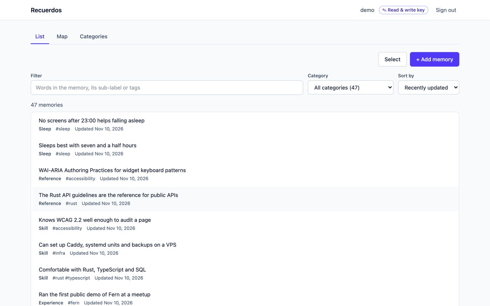
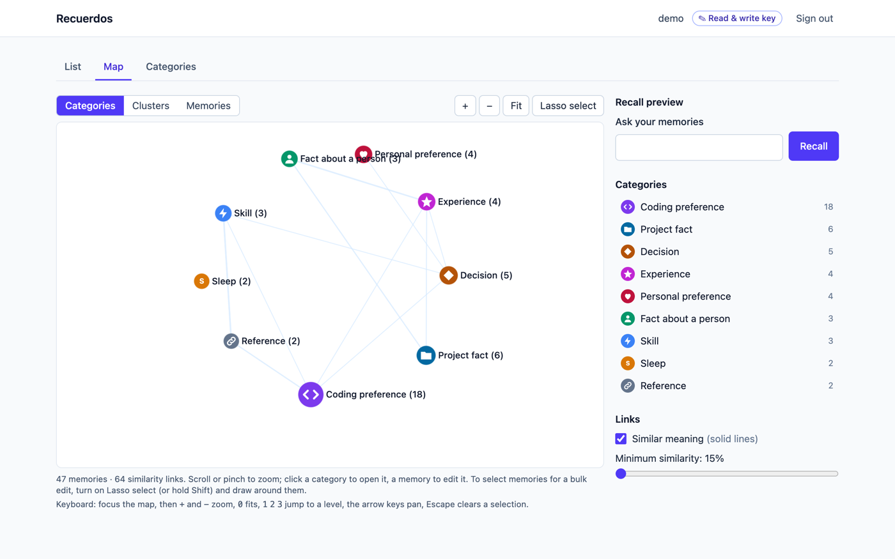
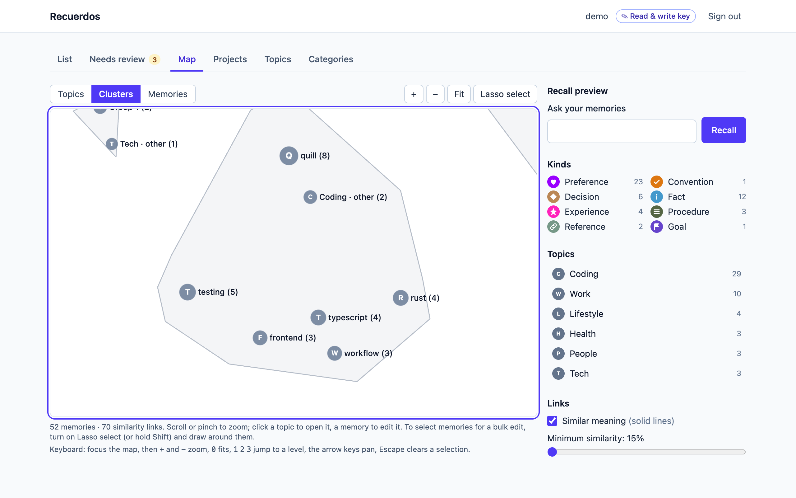
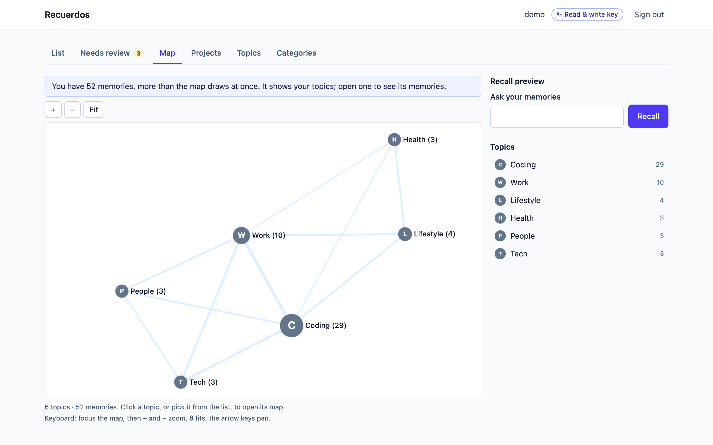
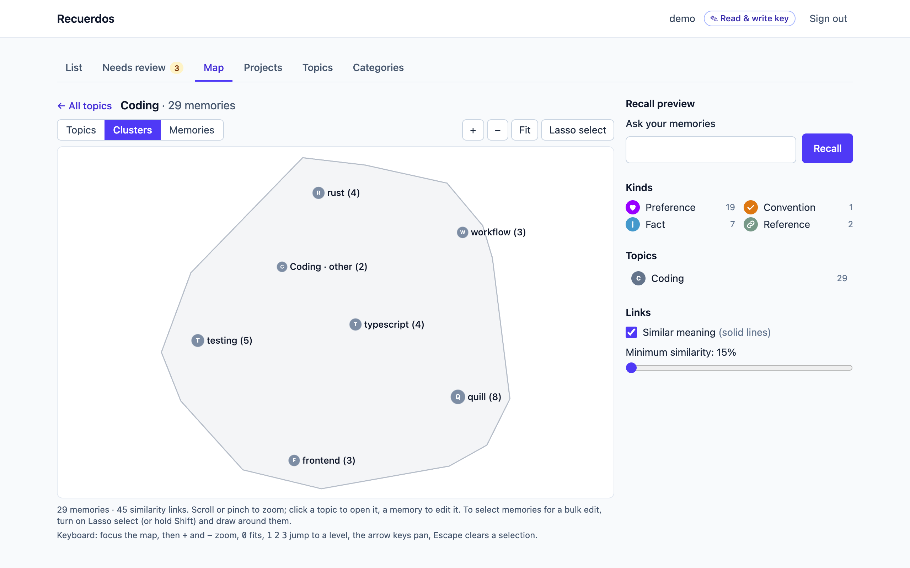
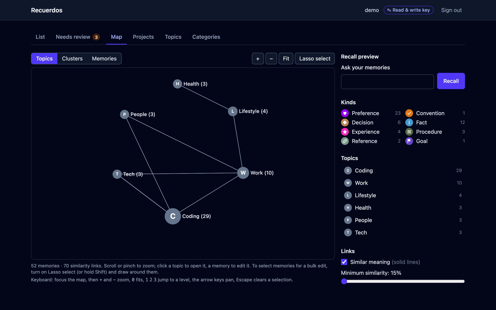
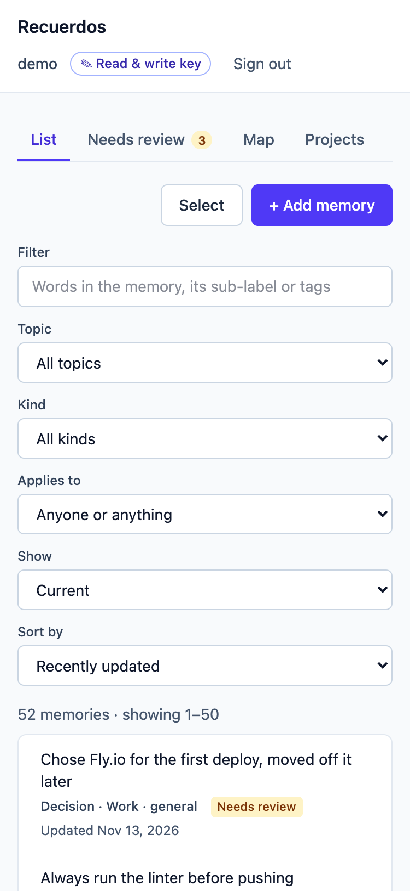
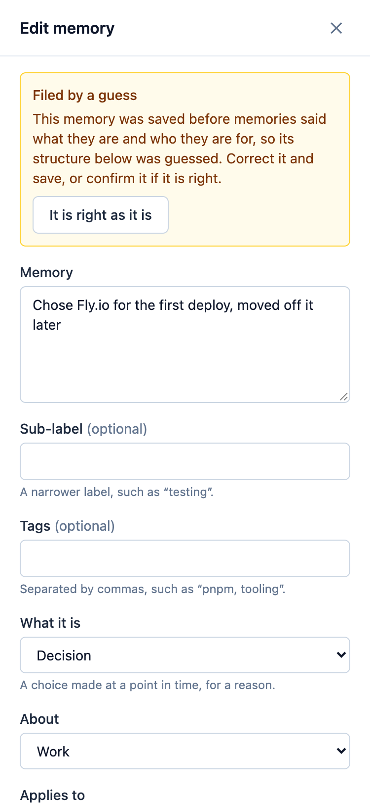

# Web UI

The daemon serves a browser UI at **`/ui`** on its API port, at
`http://127.0.0.1:7070/ui` by default. The UI is a static single-page app
compiled into the binary. It reads and writes memories through the same `/v1` API
as every other client, under the same API-key scopes.

> **Status:** complete: phases P0–P4 of [ai-specs/web-ui-plan.md](../ai-specs/web-ui-plan.md).
> You can sign in, browse, filter, correct, add and forget memories, explore
> them as a zoomable mental map with a recall preview, manage your categories,
> and edit many memories at once from the list or with a lasso on the map.
> It works from the keyboard, in light and dark mode, and at phone width.



The screenshots on this page show a demo store of made-up memories
(`web/scripts/seed-demo.mjs`); `web/scripts/screenshots.mjs` retakes them.

## The mental map

**Map** (`/ui/map`) draws your memories as a graph you zoom through.

- **Zoomed out:** one disc per category, sized by how many memories it holds,
  with lines between categories whose memories resemble each other.
- **Zooming in:** each category dissolves into its *clusters*:
  - its sub-labels, when most of its memories have one;
  - otherwise groups of similar memories, named after the tag they share most.
- **Zoomed in:** clusters dissolve into the individual memories:
  - solid lines join memories with similar meaning, thicker when more similar;
  - arrows show relations the entity graph recorded, when `[graph]` is on.





Use the scroll wheel or a pinch to zoom, or **Categories / Clusters /
Memories** to jump to a level. Clicking a category or cluster opens it.
Clicking a memory opens it in the editor.

**From the keyboard**, Tab to the map, then:

| Key | Does |
|---|---|
| `+` / `-` | zoom in / out |
| `0` | fit the whole map |
| `1` `2` `3` | jump to Categories / Clusters / Memories |
| arrow keys | pan |
| Escape | clear a lasso selection and leave lasso mode |

Jumping to a closer level closes in on the category or cluster nearest the
middle of the view. Everything else on the page is a regular button, link or
field, in reading order. The list view is the text equivalent of the map.

**The map remembers its layout.** The browser keeps the last layout of each
map in `localStorage`: memory ids, category ids and coordinates, never memory
text. It is cleared on sign-out. Reopening the map, or reloading the page,
puts everything back where it was. After an edit, only the new or re-filed
memories are placed, next to the memories they link to, and the rest stay
put. The layout is computed in a background worker, so a large store never
freezes the page.

Every category has a colour, a glyph and its name, so colour is never the
only cue. The colours keep 3:1 contrast on both the light and the dark
background. The built-ins' colours were chosen to stay distinguishable with
protanopia, deuteranopia and tritanopia, and a test checks that (see
`web/src/domain/map/palette.test.ts`). With some colour-vision deficiencies,
a few colours still look alike, which is why each category also carries its glyph and label. The legend's buttons hide and show categories. **Links** turns the
two kinds of line on and off, and raises the minimum similarity shown.

**Recall preview.** Type a question the way an agent would ("how does the user
approach testing?"):
- you see what recall returns, best first, with its relevance and which
  search found it (*meaning* is the vector search, *words* the keyword search,
  *graph* the entity hop);
- the answers light up on the map in their real places, at any zoom, while
  everything else steps back;
- clicking an answer opens it.

The map needs WebGL. Where it is missing, the page says so; the list view
shows the same memories as text.

### Large stores

Above 5 000 memories (`[ui].map_detail_limit`, see
[configuration](configuration.md)), the map opens on your categories only:
one disc each, placed so that related categories sit together. Click a
category, or pick it from the list beside the map, to open that category's
own map. It opens split into its clusters, and zooms down to its memories.
**All categories** goes back.





### Dark mode and small screens

The UI follows the system's light or dark setting, the map included, and
switches live when the system does.



At phone width the list, the filters and the editor stack into one column
with no sideways scrolling. The map works there too, though the list is the
easier view on a small screen.

<p>
  
  
</p>

## Managing memories

- **The list shows 50 memories a page**, with **Previous** and **Next** below
  it. The filter, category and sort apply to every memory, not just the page,
  and changing one goes back to page 1. A memory you just saved or restored
  opens on its own page.
- **Open a memory** from the list to see it in full. With a `write` key you can
  correct its text, category, sub-label and tags. Only the fields you
  changed are sent.
- **Edits never overwrite silently.** If an agent, consolidation or another tab
  changed the memory after you opened it, saving is refused (`412`) and your text
  is kept. You then choose:
  - **Load the latest**: discards your edit and shows the current version.
  - **Save mine anyway**: overwrites the current version with yours.
- **Add memory** saves exactly what you write, instantly, once you say **what it
  is** (a preference, a rule, a fact…), **what it is about** and **who it applies
  to**: you everywhere, one project, or in general. The choices a kind cannot take
  are greyed out (a preference is always yours), and the category follows from what
  you chose. A project name you type that is new becomes a new project. If the
  daemon refuses the save, the form shows why and keeps what you typed. See
  [memory-model.md](memory-model.md). Tick **Let the AI classify it** to send it
  through the understanding pipeline instead:
  - The pipeline may split the text into several memories, or save nothing if
    you already have it. The UI tells you which happened.
  - On a daemon without a model, the text is stored as written, and the UI says
    so.
- **Forget** asks for confirmation, then offers **Undo** for 8 seconds. Undo
  restores the same memory, with the same id and history, rather than saving a
  copy.
- **A `read`-only key** opens memories for viewing, with no edit controls.

## Editing many at once

- **From the list:** **Select** turns each row into a checkbox, with **Select
  all** for every memory the filter left, on every page, not only the one in view.
- **On the map:** **Lasso select**, or hold Shift, then draw around memories.
  Drawing around a category or cluster disc takes all its memories. The
  selection lights up where it sits on the map.

The selection opens one editor. Move everything to a category, set or clear
the sub-label, add tags, remove tags, then **Apply**. It is all or nothing: if
one memory changed underneath you (forgotten by an agent, say), nothing is
changed and the message says which.

## Categories

**Categories** (`/ui/categories`) lists every category with how many memories
it holds.

- **New category:** an id like `health.sleep` and an optional label. It can
  be used at once, by you in the editor and by your agents in `memory_save`.
  The AI classifier is offered it too.
- **Relabel** any category, built-ins included. A label only changes what you
  see; agents keep the id, and nothing is re-embedded. Leave it blank to go
  back to the default wording.
- **Edit** a custom category's id to rename it. Its memories move with it,
  and their search index is refreshed to match. Agents that filter by the old
  id need the new one.
- **Merge…** moves every memory into another category and deletes this one.
- **Delete…** an empty custom category, or say where its memories go first.
- A category marked **not in your categories** is still on some memory but
  not in your list. **Add to my categories** brings it back.

Built-in categories can be relabelled, but not renamed, merged or deleted.
Categories are per user: yours are not visible to anyone else on the daemon.

## Signing in

Paste an API key, issued with:

```bash
recuerdos-ai key issue --user <you> --scopes read,write
```

| Scope | What the UI offers |
|---|---|
| `read` | Browse memories |
| `write` (with `read`) | Browse, edit, bulk-edit and manage categories |
| `write` only | Nothing to show: the UI says the key cannot read memories |
| `admin` | Everything |

The key is kept in the tab's `sessionStorage`. It is gone when the tab closes, and it is
never put in a URL or shared with other tabs. **Sign out** clears it.

With `[auth].mode = "none"`, the UI skips sign-in. It shows a banner as a
reminder that anyone who can reach the port acts as the `default` user.

## Turning it off

```toml
[ui]
enabled = false
# Above this many memories the map opens on categories only (default 5000).
map_detail_limit = 5000
```

With the UI off, `/ui` is not mounted and answers like any path that does not exist. The
API is unaffected.

## Building

The bundle lives in `web/` (React, TypeScript, Vite, Tailwind, pnpm) and is
built into `web/dist`, which `cargo build` embeds.

```bash
just web-build     # pnpm install + build → web/dist
cargo build --release --bin recuerdos-ai
```

- **Without `web/dist`**, the daemon still builds. `/ui` then answers `503`
  with the command above. This keeps the test suite, the eval and the dev
  container free of Node.
- **Release binaries and the Docker image** always build the bundle first.
- **`--no-default-features`** drops the `ui` feature, and with it the embed,
  entirely.

End-to-end tests (Playwright, real browser against a real daemon) need a
fresh user's read/write key; they seed and change that user's memories:

```bash
RECUERDOS_KEY=ra_live_… pnpm --dir web e2e
```

For UI development, run the daemon on `:7070` and start Vite's dev server.
Vite proxies `/v1` to the daemon:

```bash
just web-dev       # http://localhost:5173/ui/
just web-test      # type-check, lint (oxlint) + unit tests
```

## Security

- **Static files only.** `/ui` serves the bundle's files, none of which
  carry data. Static files need no credential, and the rate limiter does not
  count them.
- **Strict CSP.**
  - `script-src 'self'`: no inline or third-party scripts.
  - `connect-src 'self'`: the page cannot send anything to another host.
  - `frame-ancestors 'none'`.
  - The response also carries `nosniff` and `no-referrer`.
- **Memory content is rendered as text, never as HTML.**
